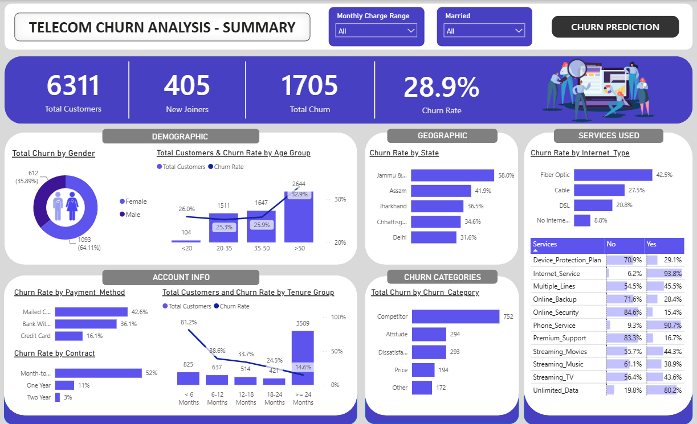
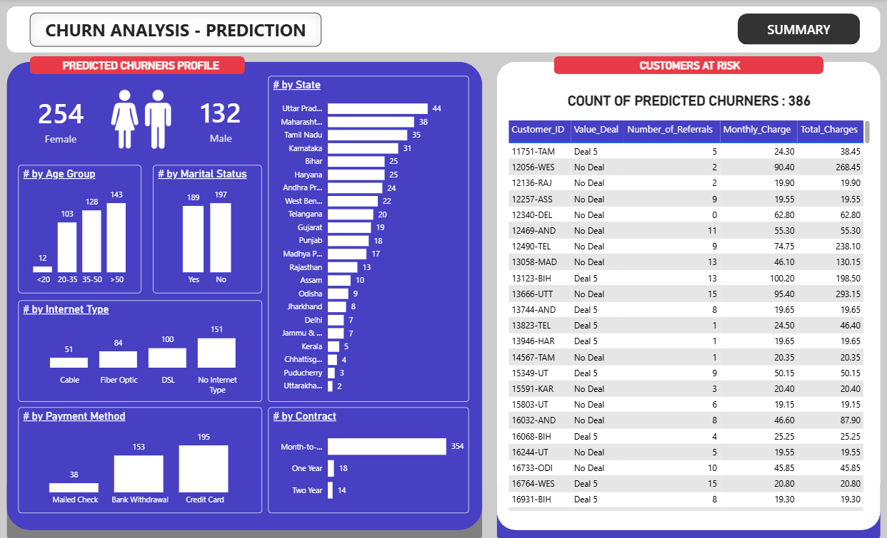

# 📡 Telecom Churn Analysis & Prediction Pipeline

**An End-To-End Churn Analytics Solution: Python data cleaning → Random Forest prediction → Power BI dashboards.**

## 📌 Overview

Customer churn is one of the most expensive problems in the telecom industry — acquiring a new customer typically costs far more than retaining an existing one. This project builds a complete pipeline that takes raw customer records, provide analytics on the existing churned customers, all the way to an actionable list of **at-risk new customers**.

1. **Python / Pandas:** Cleaned and validated the raw data, then split it into historical customers (Churned / Stayed) and new customers (Joined).
2. **Python / Scikit-Learn:** Trained a classifier on historical churn outcomes and score new customers.
3. **Power BI:** Visualised churn drivers and demographics, and profiled the customers predicted to churn.

The dataset covers **6,311 telecom customers** across Indian states (Delhi, Maharashtra, Tamil Nadu, West Bengal, etc.), with 32 attributes spanning demographics, subscribed services, contract terms, and billing.

---

## 📸 Preview

| Churn Summary | Prediction Summary |
|---|---|
|  |  |

---

## 📂 Repository Structure

```
telecom-churn-analysis-and-prediction-pipeline/
│
├── dashboard/
│   └── churn_analysis_and_prediction_dashboards.pbix        # Power BI report
├── data/
│   ├── raw/
│   │   └── Customer_Data.csv                  # Source data
│   ├── processed/
│   │   └── Customer_Data_Split.xlsx           # Cleaned data: Churned_Stayed + Joined sheets
│   └── predictions/
│       └── Predictions.xlsx                   # Model output
├── docs/
│   └── images/
│       ├── data_model.png
│       ├── summary_dashboard.png
│       └── prediction_dashboard.png
├── notebooks/
│   ├── data_cleaning.ipynb                      # Cleaning, validation, and data split
│   └── predictive_model_random_forest.ipynb     # Random Forest + scoring
├── README.md 
└── requirement.txt
```

## 🛠️ Tech Stack
- **Data Sources:** CSV, Excel
- **Data Cleaning & Modelling:** Python, Pandas, NumPy, Scikit-Learn
- **Visualisation:** Matplotlib, Seaborn, Power BI (DAX)
- **Environment:** Jupyter Notebook
